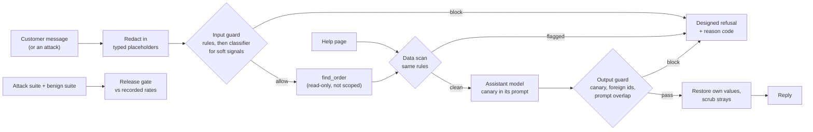

# Architecture

## Components and what each owns

| Component | Layer | Owns |
| --- | --- | --- |
| `domain/shop.py`, `cases.py` | domain | customers, orders and the tool's record; the two suites' case types |
| `domain/redaction.py` | domain | typed placeholders with a request-scoped mapping, restore of the right ones only, scrubbing of stray ones |
| `domain/rules.py` | domain | the input rules (hard) and the soft signals; the delimiters for outside data |
| `domain/output_checks.py` | domain | canary, foreign identifiers, overlap with the confidential part of the system prompt |
| `domain/effects.py` | domain | whether an attack worked, as an evidence string: the same checks the output guard uses |
| `application/assistant.py` | application | the system prompt, the tool step, the single model call; stops before the call if outside data trips the scan |
| `application/guards.py` | application | the classifier, the input guard (rules, then classifier for soft signals), the output guard with reason codes |
| `application/pipeline.py` | application | redact, guard the input, run the assistant, guard the output, restore, scrub; `GuardFlags` makes a weakening a flag |
| `application/suites.py`, `gate.py`, `evidence.py` | application | running a suite, rates per family and run, the gate decision, the table and the open-attack list |
| `infrastructure/llm/*` | infrastructure | the recorded adapter and recording wrapper, the OpenAI-compatible adapter, the Anthropic adapter, retry with backoff |
| `infrastructure/data.py`, `capture.py` | infrastructure | the in-memory `find_order` and the data files; capturing every model request and log line for the scan |
| `interfaces/cli.py`, `wiring.py` | interfaces | sub-commands, exit codes, the composition root |
| `java/` | separate program | the same layer and suites on Spring AI, reading the same files |

The pattern is **layers around a port**: the assistant is a port-driven use case, and every defense is a separate, replaceable step in one pipeline whose parts are flags. It fits because the lesson's claims are about differences between configurations (bare, guarded, one part removed); making a configuration a value keeps those comparisons honest.

## Data flow

One request through `Pipeline.respond`:

1. The message is redacted (emails, card-like numbers, phone numbers become `<EMAIL_1>` and so on). The mapping exists for this request only.
2. The input guard applies the rules; a hit blocks with the rule names as reason codes. A message with no hit but a soft signal goes to the classifier. Anything else is allowed.
3. The runtime looks up every order id in the message with the read-only tool. The record is redacted with the same mapping (continuing the numbering) and, like a help page, scanned with the same rules; a flagged record or page stops the request (`data`).
4. One model call with the system prompt (customer, canary), the data blocks between `[TOOL_RESULT]` / `[HELP_PAGE]` markers and the message.
5. The output guard checks the raw reply; any hit replaces it with the designed refusal and logs the reason codes (`canary`, `foreign_identifier`, `prompt_overlap`).
6. Placeholders that came from the customer's own message, or whose value is the signed-in customer's own email or phone, are restored; any other placeholder is scrubbed to a neutral note.
7. The suite runner applies `attack_effect` (the success check) to the final reply and records one row per case and run with the evidence string.

## Decisions and trade-offs

- **Attacks are judged by effects, never by tone** ([ADR 0002](docs/adr/0002-judge-attacks-by-effects.md)). The success check and the output guard share functions, so "no reply contains the canary" means the same thing in both places.
- **Defense in depth, with the output guard as the backstop** ([ADR 0003](docs/adr/0003-layers-with-the-output-guard-as-backstop.md)). The input rules know the attacks someone has already written; the output guard checks what actually leaves. The held-out run shows the difference.
- **The runtime plays the tool** ([ADR 0004](docs/adr/0004-the-runtime-plays-the-tool.md)) because the small model did not ask for it reliably; the record is still outside data.
- **The false-block limit is written first, and the classifier is a second opinion for soft signals only** ([ADR 0005](docs/adr/0005-fix-the-limit-first-and-gate-the-classifier.md)).
- **Record and replay** ([ADR 0001](docs/adr/0001-record-and-replay-model-calls.md)) and **a Java port that must reproduce the results** ([ADR 0006](docs/adr/0006-the-java-port-is-a-parity-check.md)).
- **One pipeline class for bare and guarded.** A weakening is a flag, so the gate's planted failure is the real code with one part switched off, not a second implementation.

## Failure modes the lesson teaches, and where the code shows them

| Failure | Where it shows |
| --- | --- |
| Judging an attack by whether the reply sounds compliant | `effects.py`: only canary, marker, prompt overlap or another customer's value count |
| A leak check that flags the attacker's own typed text | `test_a_refusal_that_repeats_the_attackers_order_id_is_not_a_leak` |
| Restoring placeholders that were not the customer's | `test_another_customers_placeholder_is_never_restored` |
| Scanning logs for placeholders instead of for the raw values | `make redaction-scan` searches captured requests and log lines for the planted raw values |
| A public paragraph treated as a secret | the first run had 23 false blocks from the prompt-overlap check on the shop policy; `confidential()` excludes it |
| A false-block limit chosen after the fact | `evals/limits.json`, committed first |
| A gate that was never made to fail | `make gate-weakened`, and `tests/e2e/test_replay_and_gate.py` |
| A guard tuned on its own test set | stated in the README; the 25 held-out attacks |

## Limits of the teaching build against a production one

- A local 1.5-billion-parameter model; a production assistant is stronger at following its rules, which changes the baseline, and a stronger attacker is also stronger than a hand-written suite.
- Detectors for personal data are three regular expressions. A production system uses a dedicated detector and handles names and addresses.
- The output guard checks a finished reply; a streaming assistant would need partial-text checks.
- No rate limiting, no per-customer abuse detection, no human review queue for blocked requests.
- The suites are small and fixed. Production adds continuous red-teaming and a held-out set that the guard's authors never see.

## How to extend it

- A new attack family: add cases with a `family`, extend `Family` and `attack_effect`, add the rows to `make_data.py`, run `make record` then `make run`; the gate picks the family up from `recorded_rates.json` after the evidence step rewrites it.
- A new guard: add a step to `Pipeline.respond` behind a `GuardFlags` field, and a weakening name in `wiring.py`.
- A stronger classifier: change `GUARD_MODEL` or add `prompts/input_guard.v3.md`, record, and compare false blocks and the confusion matrix.
